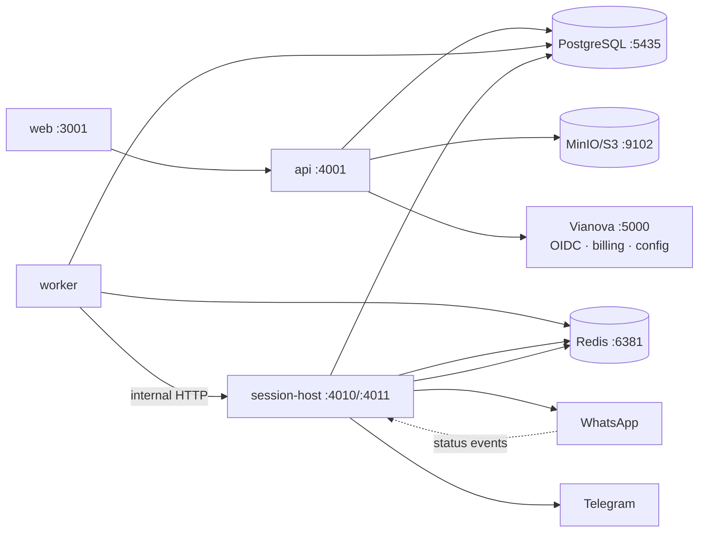

# Naia

Monorepo for the **Naia** communication brand: the `naia.website` landing
site and **Naia Campaigns** (`campaigns.naia.website`), a multi-tenant
bulk-messaging product for WhatsApp and Telegram.

**Status**: active product development on the `develop` branch. The pipeline
is at-least-once by design. See [Queue guarantees](#queue-guarantees) for the
honest delivery semantics.

## What it does

- **Campaigns**: bulk sends to contacts/segments/WhatsApp groups with
  scheduled, recurring, and window-based pacing; per-message variant rotation;
  media attachments; per-connection round-robin.
- **Automations**: birthday sends, webhook/tag/contact-created triggers, and
  multi-step cadence enrollments.
- **Contacts**: CSV/XLSX import, tags, segmentation, WhatsApp group expansion,
  opt-in/opt-out management.
- **Credits**: per-workspace credit balance debited per dispatched message,
  enforced server-side and refunded on cancellation/failure paths.

Identity, billing, and email live in **Vianova** (a sister service, not in
this repo). The API validates Vianova OIDC/JWKS tokens and receives
entitlement updates over service-to-service calls.

## Stack

| Layer | Choice | Why |
| --- | --- | --- |
| Runtime | Bun 1.3.x | single toolchain for apps, tests, scripts |
| Monorepo | Turborepo 2 | cached task graphs across 18 packages |
| API | Elysia | lightweight Bun-native HTTP framework |
| DB | PostgreSQL 16 + Drizzle ORM | relational source of truth, SQL migrations |
| Queue | BullMQ + Redis 7 | retries/backoff, dedup by jobId, delayed jobs |
| Storage | MinIO/S3 | media attachments and campaign assets |
| WhatsApp | Baileys | unofficial but widely used multi-device client |
| Telegram | GramJS (MTProto) | user-account automation |
| Frontend | TanStack Start/Router/Query | type-safe data flow via Eden Treaty client |

## Architecture



**PostgreSQL is the source of truth for all campaign state.** Redis holds only
BullMQ jobs and transient session data; a flushed Redis loses jobs, never
state; the recovery pass rebuilds from Postgres. Details:
[docs/architecture.md](docs/architecture.md),
[docs/message-processing.md](docs/message-processing.md).

## Repository layout

```
apps/landing          # naia.website marketing site
packages/
  config              # tsconfigs + brand Tailwind theme
  ui                  # brand logos/components
  vianova-auth        # OIDC/JWKS client for Vianova tokens
  vianova-email       # email queue client
  vianova-config      # config-server client
campaigns/
  apps/
    api               # Elysia API :4001: auth, campaigns, media, webhooks
    web               # product frontend :3001
    worker            # BullMQ consumers: pacer, outbound, webhooks, recovery
    session-host      # WhatsApp/Telegram socket host :4010/:4011
  packages/
    db                # Drizzle schema + migrations
    queue             # queue names, defaults, outbound queue resolution
    schemas           # shared job/message types, error sanitizer
    scheduling        # schedule computation, send windows, timezones
    entitlements      # plan tiers, credit arithmetic
    session-host-client  # typed client for session-host routes
    storage           # S3 helpers
    client            # Eden Treaty client used by the frontend
docs/                 # architecture, pipeline, security, testing, ops
```

## Prerequisites

- Bun 1.3.14 (`packageManager` field is pinned)
- Docker + docker compose (Postgres 16, Redis 7, MinIO)
- A reachable Vianova stack for auth-dependent features (not required for
  typecheck/tests; required to actually log in)

## Local setup

```bash
bun install --frozen-lockfile
cp .env.example .env          # fill in secrets; see comments inside
docker compose up -d          # postgres :5435, redis :6381, minio :9102,
                              # session-host :4010/:4011
cd campaigns/packages/db && bun run db:migrate   # apply schema
bun run dev                   # all services via turbo
# or selectively:
bun run dev:campaigns         # product only
bun run dev:landing           # landing only
```

## Tests

```bash
bun test                                          # all unit tests
# Integration suite (real Postgres + Redis, providers mocked):
docker exec naia-postgres-1 psql -U naia -c "CREATE DATABASE naia_test"
cd campaigns && bun test apps/worker/test/pipeline.test.ts
```

The worker suite covers conditional status transitions, retry exhaustion,
job dedup, webhook idempotency and ordering gates, pause/cancel refunds,
stale-send recovery, and scheduler races. **No real provider messages are
sent** because dispatch is intercepted by test senders. See
[docs/testing.md](docs/testing.md) for coverage notes and the manual provider
sandbox procedure.

## Other commands

```bash
bun run typecheck     # tsc --noEmit across all packages (turbo)
bun run build         # production builds (turbo)
cd campaigns/packages/db && bun run db:generate   # schema → migration SQL
```

## Queue guarantees

The send pipeline is **at-least-once**:

- `sending` always implies "credit debited" (claim + debit in one transaction).
- All status updates are conditional (`WHERE status = <expected>` +
  `RETURNING`); counters move only when a row actually changes.
- `failed` is terminal; `delivered`/`read` can never regress.
- Sends carry an idempotency key (`campaignMessageId`) that session-host
  deduplicates in Redis, closing most of the crash-after-delivery window.
- Residual risk: if Redis is flushed between provider acceptance and DB
  persistence, a retry can still re-deliver. This is documented rather than
  hidden. See [docs/message-processing.md](docs/message-processing.md).

## Security notes

- OIDC user auth; service-to-service routes require scoped JWKS service
  tokens or the timing-safe `NAIA_INTERNAL_SECRET`.
- Opt-out blocks WhatsApp sends at the worker, not just in the UI.
- Security headers, origin-restricted CORS, rate limiting; Swagger is off in
  production.
- `.env*` files are gitignored; `.env.example` holds placeholders only.
- See [docs/security.md](docs/security.md).

## Known limitations

- Containers currently run as root (no `USER` in Dockerfile); hardening
  follow-up.
- Telegram has no delivered/read receipts (MTProto limitation), so `sent` is
  terminal there.
- WhatsApp runs on Baileys (unofficial), subject to provider-side breakage.
- No LICENSE file yet (see below).

## License and contribution

No `LICENSE` file is currently present; the code defaults to all-rights-reserved
until the owner adds one. Contributions: see [CONTRIBUTING.md](CONTRIBUTING.md)
(branch flow: `feature/*` → `develop`, `develop` → `main` for releases).
