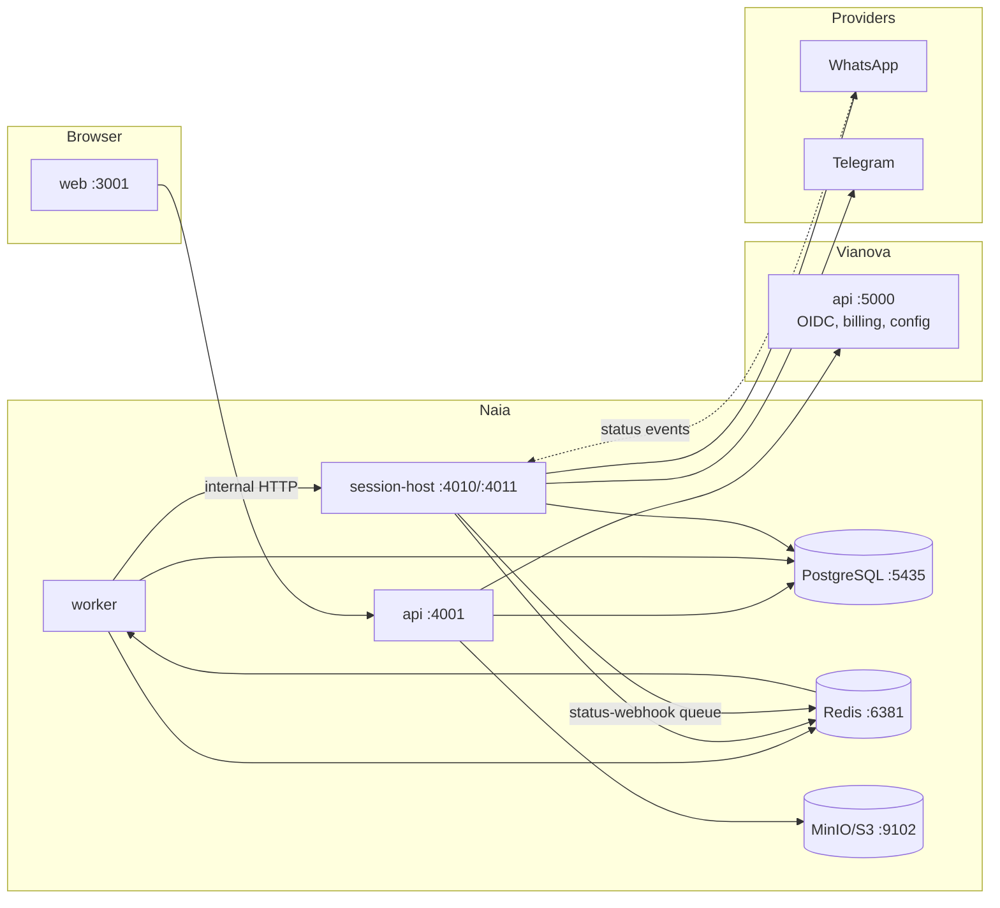

# Architecture

Naia is a Turborepo monorepo containing the Naia brand landing site and the
**Naia Campaigns** product — a multi-tenant bulk-messaging tool for WhatsApp
(Baileys) and Telegram (GramJS/MTProto user accounts).

## Services

| Service | Location | Runtime | Responsibility |
| --- | --- | --- | --- |
| landing | `apps/landing` | React/Vite | Marketing site for `naia.website` |
| web | `campaigns/apps/web` | TanStack Start | Product frontend (`campaigns.naia.website`) |
| api | `campaigns/apps/api` | Elysia (Bun) | REST API, auth, campaign orchestration |
| worker | `campaigns/apps/worker` | Bun + BullMQ | Pacer, outbound send, status webhooks, recovery, scheduler |
| session-host | `campaigns/apps/session-host` | Bun | Holds live WhatsApp/Telegram sockets; send + status webhook ingress |

Shared packages live in `campaigns/packages/` (db, queue, schemas, scheduling,
entitlements, session-host-client, storage, client) and `packages/`
(brand config/ui + Vianova auth/email/config clients).

## Data flow

## Source of truth

**PostgreSQL is the source of truth for all campaign state.** Redis holds only
BullMQ jobs and transient session data. A worker crash or Redis flush can lose
jobs, but never state: the recovery pass resurrects lost pacer jobs and stale
`sending` rows from Postgres alone. See
[message-processing.md](./message-processing.md).

## Why BullMQ + Redis + PostgreSQL

- The send pipeline needs per-connection pacing, retries with backoff, and
  crash recovery — BullMQ provides all three on Redis 7 with negligible ops
  cost (the product already needed Redis for sessions).
- Scheduling lives in Postgres (`next_run_at`, `next_pacer_at`) rather than
  BullMQ repeatables so pause/edit/cancel can never desync from the schedule —
  a missed tick self-heals on the next one.
- Delivery status is reconciled from the database, not inferred from queue
  state.

## Identity and authorization

- **User auth**: OIDC via Vianova (the shared identity provider). Login,
  registration, 2FA and Stripe all live in Vianova — this repo never
  implements them.
- **Service-to-service**: Vianova calls the API's `/internal/*` routes with
  JWT service tokens verified against Vianova's JWKS plus explicit scopes.
- **Naia-internal**: worker/scheduler → API and worker → session-host calls
  use `NAIA_INTERNAL_SECRET`, compared with `timingSafeEqual`.
- **Multi-tenancy**: every business table is `workspace_id`-scoped; all API
  routes resolve membership before reading or writing.
