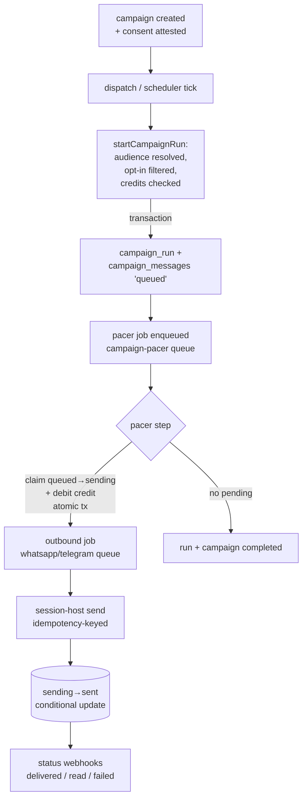

# Message processing

End-to-end lifecycle of a campaign message and the delivery guarantees the
pipeline actually provides.

## Pipeline

## Invariants

- **`sending` ⇒ credit debited.** The pacer's `queued → sending` claim and the
  credit debit happen in one Postgres transaction. Any path that removes a row
  from `sending` without a recorded send must refund the credit
  (`campaigns/packages/queue`, `apps/worker/src/lib/requeue.ts`).
- **Conditional status transitions.** Every message update is `WHERE status =
  <expected>` with `RETURNING`; counters only move when the row actually
  changed. Duplicate jobs, replayed webhooks, and concurrent workers cannot
  double-count or downgrade state.
- **`failed` is terminal.** A late `delivered`/`read` webhook after `failed`
  is ignored, and a late `failed` never downgrades `delivered`/`read`.
- **Job dedup.** Outbound jobs use `jobId = send-<campaignMessageId>`; BullMQ
  ignores re-adds while the job exists.
- **Pacer token.** `next_pacer_at` acts as a single-writer token. A pacer
  step must consume it before enqueueing the next step, so two pacer chains
  can't coexist for one run.

## Delivery semantics: at-least-once with an idempotency boundary

The system is **at-least-once**, not exactly-once. The unavoidable duplicate
window is: the provider accepts a message, then the process crashes before
`sending → sent` is persisted. Mitigations in place:

1. **Session-host idempotency keys.** Every send carries
   `idempotencyKey = campaignMessageId`. Session-host caches the result in
   Redis (bounded TTL) and returns the recorded response instead of
   re-dispatching to the provider, closing most of the crash window.
2. **Provider acknowledgement ambiguity.** If the key has expired or Redis was
   flushed, a retry may still re-send. This is the honest residual duplicate
   window, documented rather than hidden.
3. **Provider-supported IDs.** Baileys message IDs are stored as
   `external_message_id` (indexed) and used for webhook correlation.

## Failure model

| Failure | Behavior |
| --- | --- |
| Transient provider error | Throw → BullMQ retries (3 attempts, exp backoff 2s) |
| Permanent provider error | `sending → failed` immediately, no retry |
| Attempts exhausted | `failed` worker event marks message `failed`, counters reconcile |
| Worker crash after claim | `sending` row ages >10 min → recovery requeues or fails it by run status + refunds |
| Campaign paused mid-send | In-flight `sending` rows return to `queued` + refund; pacer reclaims on resume |
| Campaign cancelled | Queued → `failed` (no credit was debited); in-flight `sending` → `failed` + refund + `sent_count` decrement |
| Lost pacer (Redis flushed, worker died) | Run's `next_pacer_at` ages >3 min → recovery re-enqueues the pacer |
| Connection dropped between pick and send | Message requeued + refund; pacer re-picks among active connections |

## Scheduling

- Campaign schedules live in `campaigns.next_run_at` (Postgres). The scheduler
  tick claims due campaigns atomically (`FOR UPDATE SKIP LOCKED` +
  `next_run_at = NULL`) and asks the API to start the run; a failed API call
  restores the timestamp so the next tick retries.
- The pacer advances runs in bursts (`burstSize`/`burstPauseMs`), parks on
  send windows (`windowStart/windowEnd`, timezone-aware), and self-schedules
  the next step through `next_pacer_at`.

## Limits and honest caveats

- **Memory**: audiences are materialized per run; very large segments are
  chunked at insert (500 rows/batch) but the resolution itself is in-memory.
- **Telegram status**: GramJS/MTProto offers no delivered/read receipts;
  `sent` is the terminal reliable state for Telegram.
- **Backpressure**: per-workspace scale queues (`*-outbound-<workspaceId>`) are
  discovered from Redis metadata by the worker; base queues have fixed
  concurrency (WhatsApp 1, Telegram 5, pacer 10, webhooks 20).
- **Recovery interval**: stale `sending` detection runs every 60s with a
  10-minute staleness cutoff, so a crashed send may hold its credit for up to
  ~11 minutes before refund.
